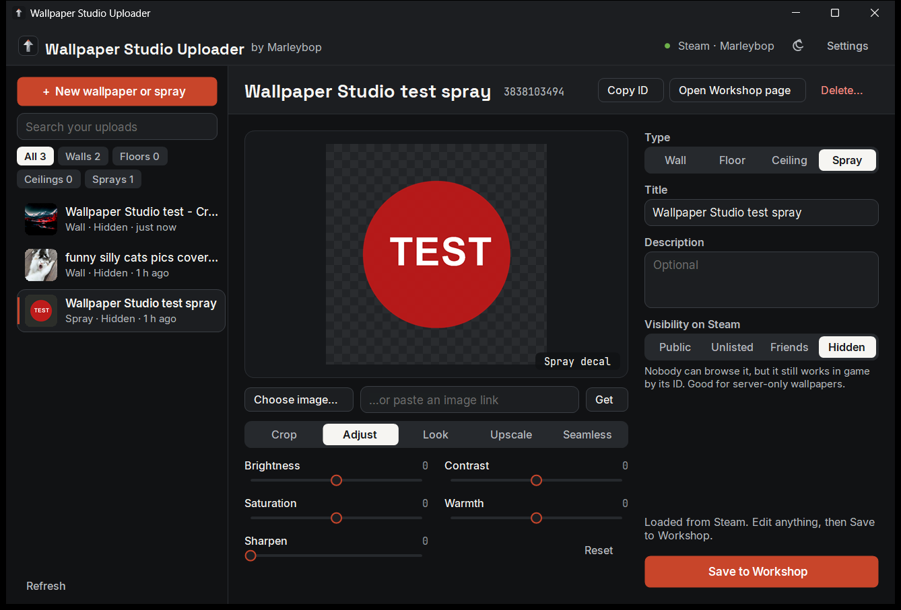

# Wallpaper Studio Uploader

A Windows app for your Rust **wallpapers** (wall, floor, ceiling) and **spray can decals**: make new ones
from any image, and edit, re-upload or delete the ones already on your Steam Workshop. No need to open
Rust's Workshop editor. By Marleybop.

## What you need
- Windows 10 or 11 (64-bit).
- **Steam running** and logged in with the account that **owns Rust**. Items are uploaded to that account.
- Nothing else to install. (The optional AI upscaler downloads itself the first time you use it.)

## Install
1. Open the [Releases page](https://github.com/Marleybop/wallpaper-studio/releases) and download
   `WallpaperStudioUploader-<version>-win-x64.zip` from the newest **Uploader** release.
2. Unzip it anywhere. Keep `WallpaperStudioUploader.exe` and `steam_api64.dll` together.
3. Start Steam, then double-click `WallpaperStudioUploader.exe`.
   - If Windows says *"Windows protected your PC"* (the app isn't code-signed): **More info → Run anyway**.
4. Top right should show a green dot and **Steam · \<your name\>**. If not, start Steam and press **Refresh**
   (bottom left).

The app follows Windows' light/dark setting (dark if Windows has none). The moon/sun button at the top
switches it; **Settings** has *Follow Windows / Dark / Light*.

## The screen
- **Left:** every wallpaper and spray your Steam account has on the Rust Workshop, newest first. Filter with
  **All / Walls / Floors / Ceilings / Sprays**, or search by name or ID.
- **Middle:** the image and its tools.
- **Right:** type, title, description and visibility, and **Save to Workshop**.

## Make a new one
1. Press **+ New wallpaper or spray**.
2. Add an image, any of these ways:
   - drop an image file on the big box, or press **Choose image…**;
   - paste a link in **…or paste an image link** and press **Get**: a direct image link or a web page with
     the image on it (Imgur, ArtStation, Reddit…);
   - drag an image straight from your browser onto the box;
   - press **Ctrl+V** to paste a copied image or link.
3. Pick the **Type**: **Wall**, **Floor**, **Ceiling** or **Spray**.
4. Use the tools under the image (next section) if you like.
5. Check the **Title**, add a **Description** if you want, choose **Visibility on Steam**:

   | Choice | Who can find it on Steam | Works in game? |
   |---|---|---|
   | Public | Everyone | Yes |
   | Unlisted | Only people with the link | Yes |
   | Friends | Your Steam friends | Yes |
   | Hidden | Only you (default) | Yes, by its ID |

6. Press **Upload to Workshop**, check the summary and press **Upload** (or Enter).
7. It appears in the list on the left. Its add command (`wpstudio.add <id> wall`) is on your clipboard.

New uploads can take a few minutes before Steam serves them in game. The first time you upload ever, Steam
may ask you to accept the Workshop agreement; the app tells you, and **Open Workshop page** gets you there.

## The image tools

| Tab | What it does |
|---|---|
| **Crop** | Drag the square on the image to choose which part is used; scroll (or the **Zoom** slider) to zoom. **Reset crop** goes back to the centre. Sprays keep the whole image unless you untick **Keep the whole image**. |
| **Adjust** | **Brightness**, **Contrast**, **Saturation**, **Warmth**, **Sharpen**. Double-click a slider to reset it; **Reset** resets them all. |
| **Look** | **Texture size** (2048 px best, 1024 px smaller download). Wallpapers also get **Repeat** (tile the image 2×2 to 8×8), **Shine** (matte to glossy) and **Surface depth**. |
| **Upscale** | For small or blurry images: AI makes the image 4× bigger and sharper first. The first time, it downloads the free Real-ESRGAN upscaler (43 MB). Needs a graphics card with Vulkan (nearly all from the last ~8 years). **Use the original instead** undoes it. |
| **Seamless** | **Blend edges** makes a pattern tile without visible seams. The image switches to a 3 × 3 tiling check so you can see the joins. |

The big box shows the crop on the **Crop** tab, the finished result on the others, and the tiling check on
**Seamless**.

## Edit one you already uploaded
1. Click it in the list. Items made with this app open exactly as you left them (crop, adjustments,
   everything). Others are downloaded from Steam and open as they are.
2. Change anything: tools, type, title, description, visibility, or drop in a new image.
3. Press **Save to Workshop**. If you only changed the text or visibility, only that is sent.

Players who already have it see the change after Steam's next update check.

## Copy, open, delete
At the top of an opened item:
- **Copy ID**, and for wallpapers **Copy add command** (paste it in the server console, or the item's ID in
  the in-game **Admin** tab).
- **Open Workshop page**.
- **Delete…** permanently deletes it from the Workshop. If your server is set up (below), tick **Also
  remove it from my server** so no dead ID is left behind.

## Your Wallpaper Studio server (optional)
**Settings → Wallpaper Studio server** lets the app add new wallpapers to your server when you save, and
remove them when you delete. Fill in:
1. **Address** and **RCON port** (the server's `rcon.port`, often 28016).
2. **RCON password** (`rcon.password`). The server needs `rcon.web 1`, the default.
3. Optional **Collection** to group new wallpapers in the in-game menu.
4. **Add new wallpapers to the server when I save**, if you want that on by default.

Then each item shows **Add it to my server when I save**. The RCON password controls the whole server, so
only set this up on a PC you trust. It's stored encrypted for your Windows account. Sprays aren't sent to
the server.

## Keyboard
**Ctrl+N** new item · **Ctrl+S** save · **Ctrl+V** paste an image or link · **Enter** confirms a dialog ·
**Esc** cancels it.

## Where things are kept

| What | Where |
|---|---|
| Each item: its source image, your edits (`edit.json`) and the built textures (`content\`) | `Documents\Wallpaper Studio Uploader\<Workshop ID>\` |
| Settings | `%APPDATA%\WallpaperStudioUploader\settings.json` |
| Thumbnails, downloaded images, the AI upscaler | `%LOCALAPPDATA%\WallpaperStudioUploader\` (safe to delete) |

## Building from source (developers)
1. Install the .NET 10 SDK.
2. In this folder run `dotnet publish -c Release -o publish`. The `publish` folder is the release:
   `WallpaperStudioUploader.exe` (self-contained) and `steam_api64.dll`.
3. Command-line modes (output goes to the console you start it from):
   - `--build <image> <wall|floor|ceiling|spray> <out folder> [--size 1024] [--tile N] [--gloss 0.25] [--bump 1]`
   - `--upload <image or link> <wall|floor|ceiling|spray> --title "Name" [--visibility hidden|unlisted|friends|public] [--id <existing ID>]`
   - `--list` lists your Rust Workshop wallpapers and sprays.
   - `--upscale <image> <out.png>` runs the AI upscaler once.

Credits: [Facepunch.Steamworks](https://github.com/Facepunch/Facepunch.Steamworks) (MIT) for Steam,
[Real-ESRGAN](https://github.com/xinntao/Real-ESRGAN) (BSD-3-Clause) for upscaling, and the Space Grotesk,
Inter and JetBrains Mono fonts (SIL Open Font Licence; licences in `Fonts\`).
